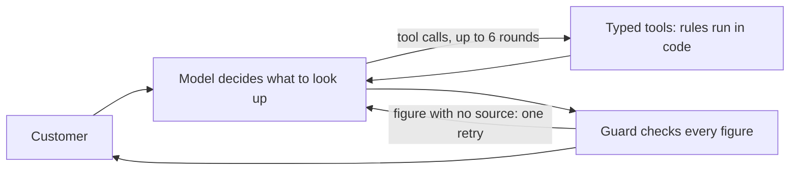

# Empório da Música: customer service agent

A text agent for a fictional musical instrument store in Campo Grande, Brazil. It answers about products, orders, returns and store policies, and it shows its work: the interface displays every lookup, every check and the cost of each reply.

**Live demo:** https://emporio-da-musica.artace.app (Portuguese by default, with a button that switches everything to English; the side panel shows the behind-the-scenes view and can be resized or hidden)

| Measured on 2026-11-01 | Result |
|---|---|
| Behavior evals, rules that must not break | 41 of 41 |
| Performance evals, slang and typos | 36 of 36 |
| Policy retrieval, 32 questions, right section in the top 3 | 100% (first position 81%) |
| Deliberately broken code caught by the free tests | 16 of 16 (`reports/mutations.json`) |
| Cost per reply | about US$ 0.0004 |
| Median model time per reply | 2.7 s |

These evals are regression tests. I wrote the cases, and the first run passed 31 of 36 before the fixes below, so 41 of 41 proves that known behaviors hold. It is not an accuracy estimate for real customers.

## Run it

Requires Python 3.12 and [uv](https://docs.astral.sh/uv/).

```bash
uv sync
uv run pytest                 # free: no API key needed, model answers come from recordings
```

To talk to the agent, copy `.env.example` values into your environment. Any OpenAI-compatible provider works; DeepSeek is the default, and Ollama is shown in the example.

```bash
export LLM_API_KEY=your-key
uv run python -m emporio.cli                                  # terminal
uv run uvicorn emporio.app:app --app-dir src --port 8000      # web UI at http://localhost:8000
```

Try orders with the fictional data: order `2` with phone `(67) 98321-6543`, or order `8`, which is late, with phone `(67) 99654-7821`.

Other commands:

```bash
uv run python scripts/evals.py behavior     # pays only for requests never recorded
uv run python scripts/evals.py performance
uv run python scripts/prove_red.py          # breaks the code on purpose, expects red tests
uv run python scripts/record_examples.py    # regenerates examples/
```

## How it works



The principle is **the model decides, the code computes**. The model chooses what to look up and writes the reply. Prices, installments, deadlines and permissions come from code.

| File | Responsibility |
|---|---|
| `src/emporio/rules.py` | The manual's rules as functions: installments, PIX, return windows, opening hours |
| `src/emporio/store.py` | Loads the CSVs; catalog search, availability, order details |
| `src/emporio/policies.py` | Splits the manual into sections, resolves contradictions, ranks with BM25 |
| `src/emporio/tools.py` | The 6 tools the model can call, with identity checks |
| `src/emporio/guard.py` | Checks each reply before the customer sees it |
| `src/emporio/graph.py` | The LangGraph flow above |
| `src/emporio/llm.py` | Provider client and answer recorder |
| `src/emporio/app.py`, `web/` | FastAPI streaming API and interface |

## Technical decisions

| Decision | Why | Rejected |
|---|---|---|
| **Function calling with typed tools** | Six narrow tools are easy to test and impossible to misuse: no tool returns another customer's data | **SQL agent:** the model could read any row, and only the prompt would stop it. **Pure RAG:** stock and prices are live data |
| **Rules in code, not in the prompt** | "7 days from receipt" must not depend on the model. Each rule has one owner, covered by unit tests at its boundary (day 7 and day 8) | Rules in the prompt: they cannot be tested without paying and tend to drift |
| **LangGraph** | The flow has a loop plus a guard that can send the reply back. A graph makes it explicit, and it gives per-conversation checkpoints | Plain loop: fine, but I would rebuild persistence and step streaming. A larger agent framework would hide the loop that matters |
| **DeepSeek Flash, thinking off** | Good tool calling at about US$ 0.0004 per reply, which makes a public demo viable. Thinking off lowers latency and cost. Provider is one setting away | Larger models: nothing in the evals asked for one |
| **Direct HTTP client** | Under 100 lines with the recorder, and it let me record answers at the exact request level | Provider SDK or LangChain wrappers: more surface and no gain here |
| **BM25 over manual sections** | The manual has 28 sections and clear headings, so a section is the natural chunk. Retrieval is free, instant, needs no second provider and can be measured offline | **Embeddings:** a vector store for 28 chunks, and DeepSeek offers no embeddings API. **Pasting the whole manual in the prompt:** cheap and viable, but it would hide which rule was used and would not scale. I would revisit if real questions miss |
| **Guard on figures** | Wrong price, wrong deadline or wrong phone are the expensive mistakes here. Each figure must appear in this turn's tool results or the customer's message. A failure gets one retry with the reason, then only that sentence is cut | **AI judge on every reply:** slower, costs money and can be wrong itself. **Replacing the whole reply:** loses the good part |
| **Short prompt** | When output was wrong I fixed data first, the tool second and the prompt last. The prompt ended up 15 lines long | Stacking rules in the prompt: several failures below were missing data, and a prompt rule would have masked them |
| **Fresh data each turn** | Old tool results leave the context, so stock and price are read again, and a figure from a past turn does not pass the guard | Keeping tool history: cheaper by one call, but it can quote a stale price |
| **Persistence on SQLite** | A customer who reloads continues the conversation, and verification stays within it. It needs no extra service | Postgres: unnecessary at this size |
| **Web UI plus CLI** | The brief allows either. The UI exposes the steps, which shows the reasoning better than any description | |

### Identity and privacy

An order opens only with the phone or e-mail on that order, checked in code before any data enters the conversation. An unknown order and a wrong contact get identical answers, so the agent cannot be used to discover which orders exist. Three failed attempts lock the conversation, and access granted to one order does not extend to another. The phone, e-mail and surname stored for a customer never reach the model.

### Public demo limits

The URL is public and each reply costs money, so limits live in code: 20 messages per visitor every 10 minutes, a daily budget of US$ 1, 800 characters per message and 700 output tokens per reply.

## Evaluation

The method separates what proves behavior from what measures quality, and it is built so that testing stays cheap.

| Layer | Where | What it answers | Cost |
|---|---|---|---|
| Unit | `tests/unit/` | Do rules, search, guard and retrieval work? | free |
| Integration | `tests/integration/` | Do the graph and the real API behave, including limits and failures? | free |
| Behavior evals | `tests/evals/comportamento/` | Did a change break something? One case for one behavior, checked by code | recorded |
| Performance evals | `tests/evals/desempenho/` | How well does it handle varied wording? A measurement that never blocks a release | recorded |

- **A model answer is paid for once.** Each one is stored by the hash of the exact request (`tests/evals/recordings/`). Unchanged requests replay for free, and a new request in replay mode fails instead of spending. That is why `pytest` needs no key. In total this project spent US$ 0.14 on model calls, about R$ 0.80, across every eval run. The last re-run after a code-only fix cost US$ 0.0006.
- **The clock is frozen in tests.** A timestamp in the prompt would invalidate every recording.
- **Cases check by code, with no AI judge:** which tool ran, with which arguments, which values appear and which must not. Each case gives a readable reason when it fails.
- **Tests must be able to fail.** `scripts/prove_red.py` applies 16 deliberate bugs, such as letting any contact open an order, and confirms the suite turns red, after a control run with no bug.
- `tests/FICHA.md` lists the mistakes that matter and the test that catches each one.

### What the evals and the examples found

| Found by | Problem | Fix | Layer |
|---|---|---|---|
| First live test | Reply said "Puxa, [nome]" | Tool returns the first name; guard rejects placeholders | tool + guard |
| Behavior eval | Product `coming_soon` described as out of stock | Availability explained in words in the tool result | data |
| Behavior eval | Guessed that a flute "might be out of stock" | Empty search says it is not in the catalog | data |
| Performance eval | "What's on sale?" found nothing | Added a promotion filter to the tool | tool |
| Behavior eval | Answered "Paris" before declining | One prompt sentence | prompt |
| Behavior eval | Replied in Portuguese to an English question | Instruction moved next to the latest message | prompt |
| Reading the UI | Called a Taylor acoustic a "guitarra" | Order items carry their category | data |
| Reading examples | Offered wind instruments the store has none of | Categories in stock go into the context | data |
| Reading examples | Guard treated the 40 in "Yamaha C40" as an invented number and cut a good answer | Model names are no longer read as quantities, with a new test and eval | guard |

The last row matters most: more than 70 green evals did not catch it, and reading a real conversation did. Reading transcripts remains part of the process.

## Data findings and assumptions

I read every CSV row and every page of the manual. Findings are in [docs/data-audit.md](docs/data-audit.md). The ones that shaped the agent:

- The manual gives two WhatsApp numbers. I use (67) 3341-4444, which is on the cover and in the company table.
- The manual sends customers to the manufacturer after 30 days, yet also grants a 90-day legal warranty. Between days 31 and 90 a person handles it.
- Only 4 of 25 promotions are active. The Takamine GD20 from the suggested scenarios has an expired one.
- The sales channel and delivery date do not exist in the data. An order with a tracking code counts as remote, and the receipt date comes from the customer or from `estimated_delivery`, flagged as an estimate.
- The newest order is from March 2026, so order age uses `DATA_AS_OF = 2026-03-25`, while opening hours use the real clock.
- Docs and code are in English as the process requested. The interface opens in Portuguese because the store's customers are Brazilian, with a button for English, and the agent always follows the language of the customer's last message.

## Known limitations

- **The customer's receipt date is trusted.** Nothing confirms it against a carrier, so a person must check it before a refund.
- **The agent does not change anything.** Refunds, cancellations and exchanges become a handoff with a protocol number; the team has no inbox for those yet, they are only stored in a table.
- **Holidays are unknown** to the opening-hours logic.
- **Replies arrive whole.** Tool steps stream live, but the text waits for the guard.
- **The guard checks figures only.** A wrong claim without a number, such as a wrong wood or a wrong policy condition, passes. Only the prompt and the evals protect against it.
- **The retrieval synonyms were written against my own questions.** The 100% is optimistic, and real questions will find gaps.
- **Rate limits and conversations live in one process.** Chat history resets if the container is rebuilt.
- **Evals ran once per case.** They show that a behavior is possible, not how often it holds; the model is not deterministic.

## With more time

1. Collect real questions, then measure retrieval and the agent against them instead of my own.
2. Add a team inbox for handoffs, and real return and cancellation actions behind confirmation.
3. Connect WhatsApp, the store's main channel, and add a webhook interface.
4. Run the same guard offline over all real conversations and review a sample every week.
5. Repeat the few cases where a mistake is costly and no code can stop it, to measure how stable they are.
6. Stream text and retract it if the guard objects.
7. Add tracing with Langfuse for cost and failures per conversation.

## Use of AI coding assistants

I used **Claude Code** (Claude Opus 5.5) throughout, and it wrote most of the code, tests and documentation in this repository, including this README. The commits carry its co-author line.

My part was direction. I defined the goal and the bar: evals, a public demo with a good interface, and decisions that could be defended. The engineering method comes from AI agents I run in production: rules in code instead of the prompt, a guard between model and customer, paying for each model answer once, testing that tests can fail, and fixing data before prompt.

The assistant worked in short cycles: read the data, build a layer, run it for real, read the output, fix, commit. The commit history shows that sequence, including the failures that shaped the design. I consider the assistant's output a draft that only counts once a test or a real run proves it, which is why most of this README's table of findings came from running the agent and not from planning it.

## Examples

Real conversations generated by the agent, including tool calls, are in [`examples/`](examples/):

1. [Catalog search and recommendation](examples/01-catalog-and-recommendation.md)
2. [Expired promotion](examples/02-expired-promotion.md), where the guard catches a figure the model calculated by itself
3. [Return policy](examples/03-return-policy.md), where the receipt date changes the decision
4. [Late order handoff](examples/04-late-order-handoff.md)
5. [Scope and security](examples/05-scope-and-security.md)
